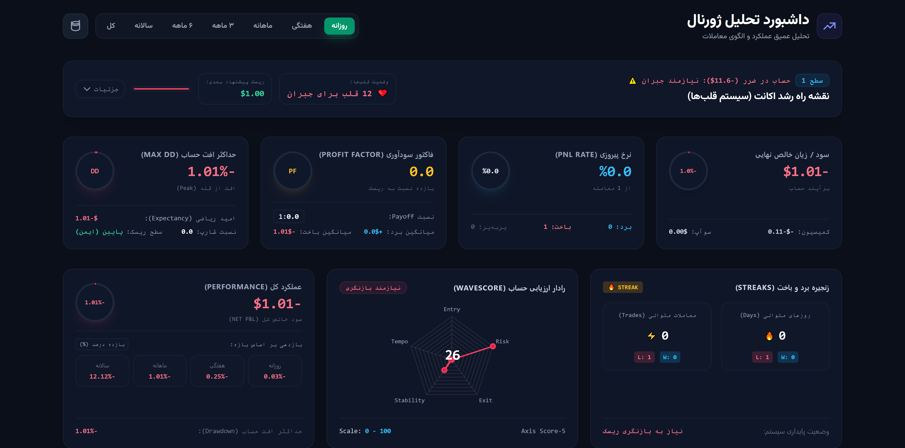

<div dir="rtl" align="right">

# 🚀 ربات دستیار و پایشگر تخصصی ترید (Trading Assistant & Journal Bot)

یک ربات تلگرام قدرتمند و چندمنظوره توسعه‌یافته با **Python** و **Django** جهت پایش بازار، ثبت ژورنال معاملاتی، استخراج اطلاعات از روی تصاویر چارت، و صدور گزارش‌های تحلیلی PDF استاندارد با تحلیل هوش مصنوعی **Gemini AI**.

---

---

# 🚀 قابلیت‌ها و ویژگی‌های کلیدی سیستم

---

### ۱. 🔔 هشدارهای قیمتی (Price Alerts)
- **پایش چندبازاره:** تنظیم هشدارهای قیمت لحظه‌ای روی جفت‌ارزهای بازار **فارکس** (از طریق MetaTrader 5 API) و **ارزهای دیجیتال** (از طریق Binance API).
- **اعلام آنی:** ارسال مستقیم پیام هشدار به تلگرام به محض برخورد قیمت با سطح تعیین‌شده.

---

### ۲. 📋 مدیریت واچ‌لیست (Watchlist Management)
- **لیست منتخب:** قابلیت افزودن و حذف آسان نمادهای معاملاتی دلخواه.
- **بررسی سریع:** دسترسی فوری به آخرین وضعیت نوسانات بازار و چارت نمادهای واچ‌لیست.

---

### ۳. 🎮 اجرای سفارشات و مدیریت لایو معاملات (Trade Execution & Live Management)
- **ثبت سفارش جامع:** قابلیت ثبت انواع سفارشات لحظه‌ای و معوق (`Market` / `Pending`) با تنظیم دقیق حجم، نقطه ورود، حد سود (`TP`) و حد ضرر (`SL`).
- **داشبورد لایو معاملات:** مشاهده آنی سود و زیان شناور (`Floating P&L`)، قیمت ورود، قیمت لحظه‌ای، فاصله تا سطوح حد سود/ضرر و نسبت سود به ریسک لایو (`R:R`).
- **مدیریت سریع معاملات (Quick Actions):**
  - 🛡️ **ریسک‌فری سریع (Break-Even):** انتقال خودکار حد ضرر به نقطه ورود تنها با یک کلیک.
  - ✂️ **خروج پله‌ای پیش‌فرض:** بستن فوری ۲۵٪ یا ۵۰٪ از حجم معامله.
  - 📊 **خروج پله‌ای سفارشی:** خروج بر حسب حجم دلخواه (مثلاً کاهش ۰.۰۵ لات) یا درصد مشخص.
  - ✏️ **ویرایش زنده سطوح:** تغییر سریع و آنلاین حد سود و حد ضرر.
  - ❌ **بستن کامل معامله (Full Exit):** خروج فوری و کامل از پوزیشن با یک کلیک.

---

### ۴. 🤖 سیگنال‌دهی RSI و تحلیل هوشمند (Gemini AI)
- **پایش اندیکاتور RSI:** شناسایی هوشمند واگرایی‌ها و مناطق اشباع خرید (`Overbought`) و اشباع فروش (`Oversold`).
- **تحلیل کندل‌استیک:** بررسی الگوهای قیمتی در تایم‌فریم‌های پایین.
- **تفسیر هوشمند:** تحلیل روان‌شناختی و ساختار بازار توسط مدل **Gemini 2.5 Flash**.

---

### ۵. 🎯 پایش خودکار حد سود و حد ضرر (SL & TP Monitor)
- **رصد پیوسته اکانت:** بررسی ۵ ثانیه‌ای تمام پوزیشن‌های فعال از طریق MetaTrader 5.
- **تشخیص دقیق علت خروج:** تفکیک خودکار دلایل بسته‌شدن معامله شامل برخورد با حد سود (`TP`)، حد ضرر (`SL`)، کال‌مارجین (`Stop Out`) یا خروج دستی/ربات.
- **اعلام پیام هشدار و گزارش روزانه:** ارسال جزئیات معامله بسته شده به تلگرام به همراه محاسبه وین‌ریت (`Win Rate`) و نمایش نمودار عملکرد روزانه (`Equity Curve`).

---

### ۶. 📝 ژورنال معاملات هوشمند و تحلیل عملکرد (Trading Journal & Analytics)
- **🤖پردازش تصویر چارت (Vision AI):** خواندن و استخراج خودکار نماد معاملاتی، قیمت ورود، حد سود، حد ضرر و حجم معامله از روی اسکرین‌شات چارت.
- **📝ثبت دستی آسان:** فرم‌بندی ساده و سریع جهت ثبت اطلاعات پوزیشن‌ها در دیتابیس.
- **⚖️دسته‌بندی هوشمند نتایج (WIN / LOSS / BE)**: پیاده‌سازی منطق پیشرفته برای تشخیص دقیق معاملات سربه‌سر (Breakeven) بر اساس تلورانس و دوری از قیمت ورود، جهت حفظ یکپارچگی وین‌ریت و جلوگیری از ثبت سودهای ناشی از نویز یا کمیسیون به عنوان برد.

- **🎯رادار ارزیابی حساب (WaveScore Radar Pro)**: آنالیز ۵ بعد کلیدی ترید (Entry، Risk، Exit، Stability، Tempo) با امتیازدهی هوشمند و تغییر رنگ خودکار نمودار بر اساس سلامت و وضعیت کلی حساب.

- **📊شاخص‌های کلیدی عملکرد (KPIs)**: محاسبه و نمایش پویا سود/زیان خالص (Net PnL)، وین‌ریت، فاکتور سودآوری (Profit Factor)، نسبت شارپ (Sharpe Ratio)، نسبت پرداخت (Payoff)، امید ریاضی (Expectancy) و حداکثر افت حساب (Max Drawdown).

- **⏳بازدهی بازه‌های زمانی (Period Returns)**: پایش لحظه‌ای و تفکیک‌شده بازدهی حساب در بازه‌های روزانه، هفتگی، ماهانه و سالانه با قابلیت تغییر واحد نمایش (درصد و دلار).

- **🔥زنجیره برد و باخت (Winstreaks)**: ردیابی مداوم بیشترین تعداد روزها و معاملات متوالی سودده یا زیان‌ده همراه با نشانگرهای بصری.
---

### ۷. 📊 گزارش‌گیری تخصصی به سبک وال‌استریت (Wall Street Standard PDF)
- **منحنی رشد حساب (Equity Curve):** ترسیم هوشمند و خودکار روند سود و زیان تجمیعی.
- **تحلیل افت حساب (Drawdown Graph):** نمایش گرافیکی میزان درگیر شدن سرمایه و حداکثر افت حساب (`Max Drawdown`).
- **شاخص‌های کلیدی مدیریت ریسک:**
  - **Sharpe Ratio (نسبت شارپ):** سنجش میزان بازدهی نسبت به ریسک کل.
  - **Sortino Ratio (نسبت سورتینو):** سنجش بازدهی نسبت به نوسانات منفی.
  - **Profit Factor (ضریب سودآوری):** مجموع سودها به مجموع زیان‌ها.
  - **Payoff Ratio & Expectancy:** میانگین نسبت سود به زیان و امید ریاضی.
- **تفکیک نرخ موفقیت:** نمودار میله‌ای وین‌ریت به تفکیک هر نماد.
- **ارزیابی هوشمند استراتژی:** تحلیل متنی کیفیت عملکرد توسط **Gemini AI**.

---

### ۸. 🎮 ویجت گیمیفاید نقشه راه رشد اکانت (سیستم قلب‌ها و مراحل نامحدود)

این پروژه مجهز به یک سیستم پیشرفته و بازی‌گونه (Gamification) برای مدیریت سرمایه و رشد حساب است که به‌صورت هوشمند به تریدر انگیزه می‌دهد. ویژگی‌های کلیدی این بخش شامل موارد زیر است:

- **محاسبه مستقل از فیلترهای داشبورد:** تمامی محاسبات پیشرفت مستقیماً از کل تاریخچه معاملات واقعی کاربر خوانده می‌شوند تا فیلترهای زمانی یا نمادها در داشبورد، روند اصلی نقشه راه را تغییر ندهند.
- **مراحل نامحدود و پویا (Infinite Progression):** سیستم به صورت پله‌ای (بر پایه ریسک اولیه ۱ دلار و ضریب R/R 4) جلو می‌رود و همیشه **۴ مرحله‌ی پیشِ رو** را به همراه هدف قلب‌ها و سود تجمعی نمایش می‌دهد.
- **مدیریت هوشمند ضرر و درصد پسرفت:** تا زمانی که کل حساب در وضعیت ضرر (منفی) باشد، سیستم وارد مراحل صعودی نمی‌شود و میزان پسرفت و افت از تعادل را به صورت درصد و با نوار هشدار قرمز رنگ به کاربر نشان می‌دهد.
- **صندوقچه‌های پاداش (Payout Milestones):** در مراحل خاص (هر مرحله چهارم)، پاداش خروج ۱۰٪ از سود تجمعی برای تشویق کاربر فعال می‌شود.
- **طراحی کشویی و بهینه (Expandable Accordion):** ویجت به صورت کاملاً مینیمال طراحی شده؛ ریسک پیشنهادی معامله بعدی همیشه در هدر قابل مشاهده است و با یک کلیک می‌توانید جزئیات کامل و مراحل بعدی را باز کنید.
---

## 🛠️ تکنولوژی‌ها و پیش‌نیازها

- **Language:** Python 3.13.15 (Windows Native)
- **Framework:** Django (جهت مدیریت ORM و دیتابیس)
- **Telegram Library:** `python-telegram-bot`
- **AI Model:** `google-genai` (Gemini API)
- **Data & Charts:** `matplotlib`, `numpy`, `pandas`
- **PDF Generation:** `reportlab`, `arabic-reshaper`, `python-bidi`
- **Market Data APIs:** MetaTrader 5 (MT5), Binance API
- **Terminal Requirement:** **Windows Terminal** (`wt`) جهت اجرای رنگی و تب‌بندی‌شده اسکریپت‌ها در ویندوز.

---

## ⚙️ نصب و راه‌اندازی (Installation)

1. مخزن را کلون کنید یا فایل‌ها را در پوشه پروژه قرار دهید:
   ```bash
   git clone [https://github.com/suniali/crypto75_bot.git](https://github.com/suniali/crypto75_bot.git)
   cd crypto75_bot
   ```

2. فایل .env را در کنار manage.py بسازید و مقادیر زیر را قرار دهید:
  ```bash
  TELEGRAM_BOT_TOKEN=your_bot_token_here
  SECRET_KEY=your_django_secret_key
  GEMINI_API_KEY=your_gemini_api_key
  ```
  ## چگونه SECRET_KEY اختصاصی بسازیم؟
  برای ساختن یک کلید امن و تصادفی برای جنگو، کافی است ترمینال (یا CMD) را در مسیر پروژه باز کرده و دستور زیر را اجرا کنید تا کلید خودکار برایتان تولید شود:
  ```bash
  python -c "import secrets; print(secrets.token_urlsafe(50))"
  ```

3. اجرای سیستم (به صورت خودکار):
- **پیش‌نیاز مهم**: مطمئن شوید نرم‌افزار Windows Terminal روی ویندوز شما نصب است (قابل دریافت رایگان از Microsoft Store).
- برای اجرای هم‌زمان سرور جنگو و ربات در تب‌های رنگی و مدرن، کافی است روی فایل run.bat که در ریشه پروژه قرار دارد، دو بار کلیک کنید.


</div>